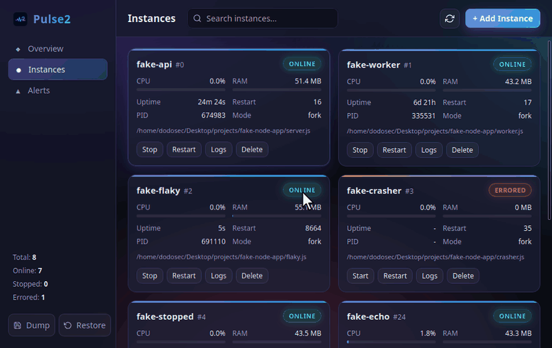
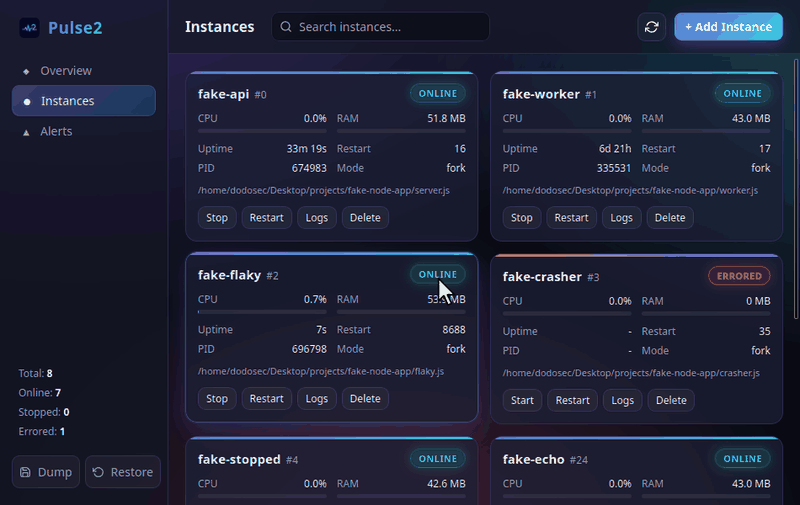
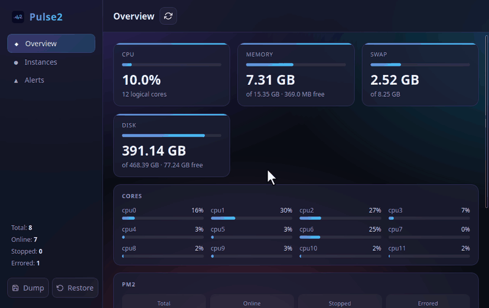
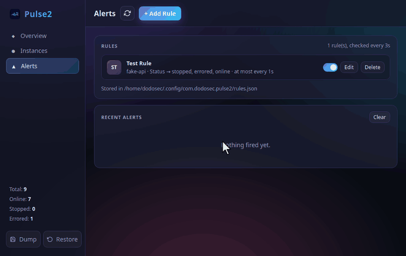

<div align="center">


# Pulse2

**A small, fast desktop app for managing your [pm2](https://pm2.keymetrics.io/) processes.**

See what is running, restart what is stuck, read logs, and get a desktop notification when something goes down.


</div>

---

## 📖 What is this?

`pm2` is great, but living in `pm2 ls`, `pm2 logs` and `pm2 monit` gets tiring.
**Pulse2** puts the same information in one window and adds alerting on top.

It does not replace pm2 and it does not run its own daemon. It talks to the pm2 that is already installed on your machine, through the regular `pm2` command line. Whatever you do in the app is the same as typing the command yourself, so the app and your terminal always agree.

<div align="center"></div>

## ✨ Features

| | |
|---|---|
| 📋 **Instances** | Every pm2 process as a card: status, uptime, restarts, CPU and memory meters. Search by name. |
| ▶️ **Process control** | Start, stop, restart and delete, with a confirmation before anything destructive. |
| 📜 **Logs** | Read the latest log lines of any process without leaving the app. |
| ➕ **New instance** | Start a script with a form (name, cwd, interpreter, args, env, cluster mode, watch), or pick an ecosystem file, edit it in place and apply it. |
| 💾 **Dump & restore** | Save the current process list to a file of your choice and bring it back later. |
| 🖥️ **Overview** | System CPU (per core), RAM, swap and disk at a glance, next to a summary of your pm2 processes. |
| 🔔 **Alerts** | Rules for CPU usage, memory usage, restarts and status changes. When a rule fires you get an in-app toast and a native desktop notification. |

## 🎬 Tour

### Instances

Search by name, control each process and read its logs.


### New instance

Fill in the form, press Add, and the new process shows up in the list. An ecosystem file works too.



### Overview

System CPU per core, memory, swap and disk, next to a pm2 summary.



### Alerts

Rules for CPU, memory, restarts and status changes. Here a status rule is created, the process is stopped, and the alert arrives as a desktop notification, an in-app toast and an entry under Recent alerts.



## 🔔 Alert rules

Rules are created from the **Alerts** page. Each rule has a name, a target process and a condition.

| Type | Fires when | Threshold |
|---|---|---|
| **CPU usage** | the process uses more CPU than the threshold | percent of one core |
| **Memory usage** | the process uses more memory than the threshold | MB, or percent |
| **Restarts** | the restart counter grows between two checks | number of restarts |
| **Status change** | the process moves into one of the picked states | `stopped`, `errored`, `online` |

For a memory rule in percent, the base is the app's `max_memory_restart` limit when it has one, and the total system RAM otherwise.

Rules are stored as plain JSON in the app's config directory. On Linux that is:

```
~/.config/com.dodosec.pulse2/rules.json
```

A stored rule looks like this:

```json
{
  "id": "fAPGwm",
  "alert_type": "StatusChange",
  "name": "API went down",
  "target": "api",
  "threshold": 0.0,
  "threshold_unit": "None",
  "alert_cooldown": 60,
  "statuses": ["stopped", "errored"],
  "is_enabled": true,
  "triggered_at": null,
  "created_at": 1794763099,
  "updated_at": 1794943324
}
```

## 📦 Requirements

- **pm2**, installed and available on your `PATH` (`npm install -g pm2`)
- **Rust** 1.90 or newer ([rustup.rs](https://rustup.rs))
- **Tauri CLI** v2
- The **Tauri system dependencies** for your OS. See the [Tauri prerequisites guide](https://tauri.app/start/prerequisites/).

On Debian or Ubuntu the system dependencies are:

```bash
sudo apt update
sudo apt install libwebkit2gtk-4.1-dev build-essential curl wget file \
  libxdo-dev libssl-dev libayatana-appindicator3-dev librsvg2-dev
```

There is no Node build step. The frontend is a single HTML file.

## 🚀 Getting started

```bash
# 1. Get the code
git clone https://github.com/DogukanGezer/pulse2.git
cd pulse2

# 2. Install the Tauri CLI (once)
cargo install tauri-cli --version "^2" --locked

# 3. Run in development mode
cargo tauri dev
```

The first build compiles all dependencies and takes a few minutes. Later builds are fast.

### Build an installable package

```bash
cargo tauri build
```

The bundles are written to `target/release/bundle/`. On Linux you get a `.deb`, an `.rpm` and an `.AppImage`.

## 🗂️ Project layout

```
pulse2/
├── src/                  Core library, no Tauri in here
│   ├── services/
│   │   ├── process.rs    pm2 commands: list, start, stop, restart, delete, logs, dump
│   │   ├── system.rs     CPU, memory, swap and disk stats
│   │   ├── alert.rs      Alert rule validation and CRUD
│   │   ├── store.rs      In-memory rule store, persisted to rules.json
│   │   ├── watcher.rs    Background loop that evaluates the rules
│   │   └── types.rs      Shared data types
│   └── utils/            Path safety helpers
├── src-tauri/            Tauri shell: commands, app setup, notifications
└── ui/index.html         The whole frontend, plain HTML, CSS and JS
```

The split is deliberate. Everything that knows about pm2 lives in the library. The Tauri crate only exposes it to the window.

## ⚙️ How it works

- **pm2 through its CLI.** The app runs `pm2 jlist` and parses the JSON, and runs `pm2 start`, `pm2 restart` and friends for actions. The CLI is pm2's stable public interface.
- **Polling.** The window refreshes every 3 seconds. The alert watcher runs on its own thread and checks every 2 seconds.
- **Alerts compare snapshots.** Restarts and status changes are detected by comparing each check with the previous one, so a restart is not missed even if the process is back online before the next check.
- **Files stay in your home directory.** Paths coming from the window are restricted to existing `.js` and `.json` files under your home directory. Applying an ecosystem file keeps a `.bak` copy of the original next to it.

## 🧭 Status and roadmap

This is an early version. It is developed and tested on **Linux**.

- [x] Process list, control, logs
- [x] New instance from a form or an ecosystem file
- [x] Dump and restore
- [x] System overview
- [x] Alert rules with in-app and desktop notifications
- [ ] Alert cooldown, so a rule does not repeat on every check
- [ ] Rules that target all processes
- [ ] macOS testing
- [ ] Windows support (pm2 is installed as `pm2.cmd` there, which the app does not handle yet)
- [ ] Event based watching instead of polling

## 🤝 Contributing

Issues and pull requests are welcome. For anything larger than a small fix, please open an issue first so we can agree on the approach.

```bash
cargo check          # quick type check
cargo tauri dev      # run the app
```

## 📄 License

No license has been chosen yet. Until one is added, the code is published for reading only. A `LICENSE` file will follow.

---

<div align="center">
Built with <a href="https://tauri.app">Tauri</a> and Rust.
</div>
